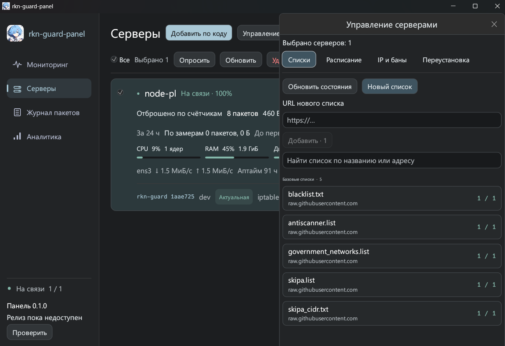

<h1 align="center">rkn-guard-panel</h1>
<p align="center">Портативная Windows-панель для Linux-серверов, на которых установлен скрипт <a href="https://github.com/Flecksis/rkn-guard">rkn-guard</a>.</p>
<p align="center"><a href="#подключение">Подключение</a> · <a href="#управление">Управление</a> · <a href="#сборка">Сборка</a></p>

<p align="center"></p>

## Подключение

1. На сервере с [rkn-guard ](https://github.com/Flecksis/rkn-guard/) откройте меню `rkn` и выберите «Подключить к панели rkn-guard-panel».
2. Скачайте [rkn-guard-panel.exe из последнего релиза](https://github.com/Flecksis/rkn-guard-panel/releases/latest/download/rkn-guard-panel.exe) и запустите его. В разделе «Серверы» нажмите «Добавить по коду», укажите имя и вставьте одноразовый код.
3. Панель подключится по SSH. При следующем запуске она использует сохранённый ключ.

## Управление

Отметьте серверы и нажмите «Управление». Здесь можно менять расписание обновления подсетей, включать списки, снимать ручные баны и управлять исключениями. У каждого правила видно, где оно действует. Обновление и переустановку rkn-guard можно запустить на нескольких узлах сразу.

Нажмите на сервер, чтобы открыть графики CPU, памяти, сети и отброшенных пакетов. История хранится на компьютере в папке `data` рядом с EXE.

## Сборка

На Windows x64 с Rust и C-компилятором запустите:

```powershell
.\build.ps1
```

Готовая панель — `dist/rkn-guard-panel.exe`.
